<div align="center">

# GitHub Stats Card

**A combined GitHub Stats + Languages card with the [Energy Rhythm](https://github.com/hugotakeda/Energy-Rhythm-Contribution-Graph) palette.**  
Automatically generates a premium SVG showing your stats and most used languages side by side.

[](./LICENSE)

</div>

---

<div align="center">

## Preview

<p align="center">
  
</p>

</div>

---

## Features

| Left Panel | Right Panel |
|---|---|
| ⭐ Total Stars | 📊 Language bar (proportional) |
| 🔥 Total Commits (year) | 🎨 Top 6 languages with % |
| 🔀 Total PRs | |
| ❗ Total Issues | |
| 📦 Contributed to | |
| 🏅 Grade ring (S → C) | |

- **Dark theme** matching the Energy Rhythm palette
- **CSS animations** (fade-in, ring draw, bar grow)
- **Zero dependencies** — pure Node.js with built-in `fetch`
- **Daily updates** — also runs on push or manual trigger

---

## Quick Start (5 minutes)

1. **Fork** this repository.

2. Generate a **Personal Access Token (classic)** with `repo` and `read:user` scopes at [github.com/settings/tokens](https://github.com/settings/tokens).

3. In your fork, go to **Settings → Secrets and variables → Actions** and add a new secret:
   - **Name:** `STATS_TOKEN`
   - **Value:** *(your generated token)*

4. Go to the **Actions** tab, select **Generate GitHub Stats SVG**, and click **Run workflow**.

5. Add the generated SVG to your profile README:

```markdown
<p align="center">
  
</p>
```

---

## Grade Scale

| Grade | Percentile | Meaning |
|:---:|:---:|---|
| **S** | ≥ 95% | Legendary |
| **A+** | ≥ 85% | Outstanding |
| **A** | ≥ 70% | Excellent |
| **B+** | ≥ 55% | Great |
| **B** | ≥ 40% | Good |
| **C** | < 40% | Getting started |

---

## License

[MIT](./LICENSE)

## Lines of Code card

A separate 775px card is generated at `dist/lines-of-code.svg`. Place it between
your stats card and contribution graph:

```html
<p align="center">
  
</p>
```

The card displays **Net lines changed**, **Lines added**, and **Lines removed**.
Net is additions minus deletions; it can be negative. This is historical textual
change volume, not a count of currently surviving code or a productivity score.

Counting rules:

- All available history of commits authored by the selected GitHub account.
- Public repositories owned by that account, excluding forks; default branches only.
- All text files, including documentation, generated files, and imported content.
- Known automatic graph-refresh commits are excluded by repository name, exact
  commit message, and bot committer, even when older refreshes list you as author.
- GitHub matches authors using the account ID. Unlinked author emails may be absent.
- Totals are summed per repository, like the reference implementation; history
  copied between separate non-fork repositories may be counted in each one.
- Repositories and commit histories are fully paginated. Each history is pinned
  to its discovered head commit.
- A versioned Actions cache stores totals by repository head and author ID.
  Unchanged heads are reused; changed heads are recomputed. Cache misses are safe.
- Failed API requests fail generation instead of publishing a partial or zero count.
- The existing `STATS_TOKEN` is reused. Generated images are committed as the bot.

Run `npm run generate:loc` with `GITHUB_USERNAME` and `GH_TOKEN` set, and
`npm test` for regression tests. After merging, wait for the first successful
workflow to create the SVG before adding its URL to a profile README.
